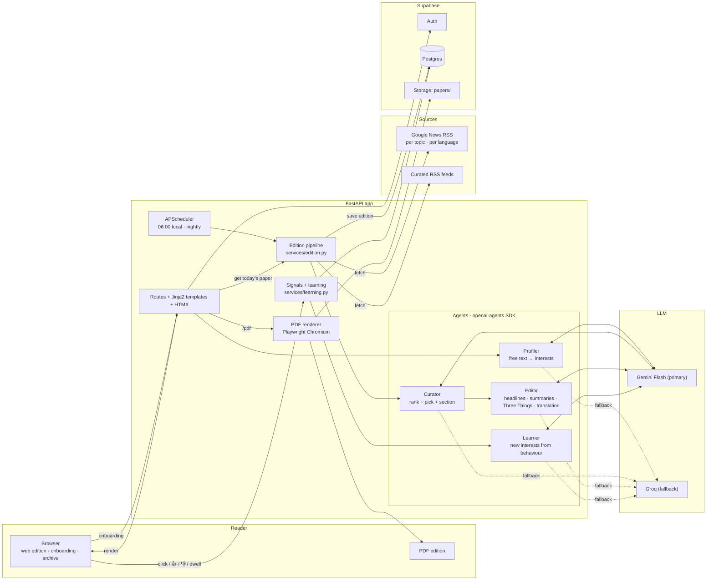
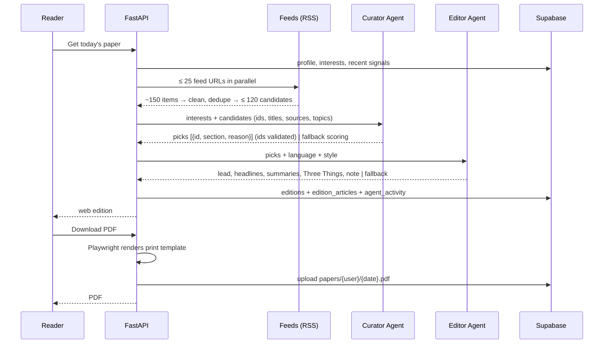

# 03 — Technical Design: Subah

## 1. Stack (pinned — versions checked 2026-10-17)

`requirements.txt`:
```
fastapi==0.143.3
uvicorn[standard]==0.54.0
jinja2==3.1.6
python-multipart==0.0.32
pydantic==2.14.1
pydantic-settings==2.16.0
supabase==2.33.0
openai-agents==0.24.0
feedparser==6.0.14
httpx==0.28.1
rapidfuzz==3.14.6
playwright==1.63.0
babel==2.18.0
apscheduler==3.11.3
tenacity==9.2.1
slowapi==0.1.10
pywebpush==2.5.0
pytest==9.1.1
pytest-asyncio==1.4.0
respx==0.23.1
ruff==0.17.1
```
(`openai` is installed as a dependency of `openai-agents`; do not pin it separately.)
After install: `playwright install chromium`.

Frontend (no build step): Jinja2 templates + one CSS file + HTMX from a CDN
(`https://unpkg.com/htmx.org@2.0.4/dist/htmx.min.js`) + Lucide icons
(`https://unpkg.com/lucide@0.460.0/dist/umd/lucide.min.js`) + Google Fonts. Small vanilla JS
only for: onboarding swipe cards, dwell beacon, timezone detection, `speechSynthesis`,
client-side search filter, push subscription (`static/push.js`), service worker (`static/sw.js`).

| Library | Job |
|---|---|
| FastAPI + Jinja2 | all pages and HTMX fragments |
| supabase | Auth (email/password), Postgres, Storage (PDFs) |
| openai-agents | Profiler, Curator, Editor, Learner agents (typed outputs) |
| feedparser + httpx | fetching and parsing RSS/Atom |
| rapidfuzz | near-duplicate headline removal |
| playwright | HTML → PDF with real fonts for every script |
| babel | localized dates ("Saturday, 17 October 2026" / "ہفتہ، 17 اکتوبر 2026") |
| apscheduler | 06:00 local-time editions + nightly learning |
| tenacity, slowapi | retries; rate limits on auth and generate |
| pywebpush | morning notification (VAPID web push, F-21) |
| pytest, pytest-asyncio, respx, ruff | unit + integration tests, HTTP mocking, lint (ship gate) |

## 2. Architecture



Edition sequence:


## 3. Repository layout

```
subah/
├── AGENTS.md  CLAUDE.md  README.md  .env.example  .gitignore  requirements.txt
├── Dockerfile  render.yaml  pytest.ini  .dockerignore
├── .claude/agents/  shipper.md  deployer.md      # Claude Code subagents (ship gate + deploy)
├── .github/workflows/ci.yml                      # tests on every push; deploy on main after tests
├── scripts/  ship.sh  deploy.sh  smoke.sh  gen_vapid.py  seed_demo.py
├── tests/  unit/  integration/  conftest.py
├── docs/
├── supabase/schema.sql               # 04_DATA.md §2, run once in the SQL editor
└── app/
    ├── main.py                       # FastAPI app, lifespan (Playwright browser + scheduler), routers, static, limiter
    ├── config.py                     # Settings + constants (§5)
    ├── deps.py                       # supabase client, require_user, current_lang, templates + t()
    ├── i18n/  en.json ur.json ar.json hi.json bn.json es.json fr.json zh.json
    ├── data/  topics.json  feeds.json  languages.json  sources.json  stopwords.json
    ├── models.py                     # Pydantic: agent outputs, form models, enums
    ├── routers/
    │   ├── auth.py                   # /signup /login /logout
    │   ├── onboarding.py             # /onboarding, /onboarding/step/{n}, /onboarding/parse, /onboarding/taste
    │   ├── paper.py                  # /paper/today, /paper/{date}, /paper/{date}/pdf, /paper/{date}/making-of, /paper/generate
    │   ├── archive.py                # /archive
    │   ├── signals.py                # /r/{edition_article_id}, POST /signals
    │   ├── profile.py                # /profile, /settings, /settings/comfort, /suggestions/{id}
    │   ├── reader.py                 # /saved, /mutes, /sources, /paper/{date}/a/{id}
    │   ├── puzzle.py                 # /puzzle/{date}, /puzzle/{date}/answer
    │   └── push.py                   # /push/*, /sw.js
    ├── agents/
    │   ├── llm.py                    # build_model('provider:model_id'), set_tracing_disabled(True)
    │   ├── runner.py                 # run_agent(): primary → fallback model → None
    │   ├── profiler.py  curator.py  editor.py  learner.py
    ├── services/
    │   ├── feeds.py                  # build_feed_urls, fetch_all, normalise, dedupe
    │   ├── edition.py                # generate_edition (the pipeline)
    │   ├── layout.py                 # slots, sections order, columns per style
    │   ├── pdf.py                    # render_pdf (Playwright), upload
    │   ├── learning.py               # apply_signal, nightly_decay, maybe_run_learner
    │   ├── activity.py               # log(edition_id, agent, kind, message, data)
    │   ├── mutes.py                  # filter_muted(cands, keywords, lang)
    │   ├── sources.py                # catalog, validate_custom_feed(url)
    │   ├── puzzle.py                 # build_from_editor / fallback_items, grade, streak
    │   ├── push.py                   # send_ready(user_id, edition) via pywebpush
    │   ├── reading.py                # read_ids_for_edition, saved toggle
    │   └── i18n.py                   # load_tables(), t(key, lang, **vars), dir(lang), full_date(value, lang), languages()
    ├── jobs.py                       # scheduler jobs
    ├── templates/
    │   ├── base.html  landing.html  login.html  signup.html
    │   ├── onboarding.html  _ob_step1.html … _ob_step5.html  _taste_card.html
    │   ├── edition.html              # web edition
    │   ├── edition_print.html        # PDF edition (extends _edition_body.html)
    │   ├── _edition_body.html        # shared newspaper markup
    │   ├── _article.html  _article_sheet.html  _bottom_nav.html  archive.html  saved.html
    │   ├── profile.html  settings.html  sources.html  puzzle.html  making_of.html
    └── static/  app.css  paper.css  print.css  app.js  push.js  sw.js  favicon.svg
```

## 4. Module contracts (implement these signatures)

```python
# services/feeds.py
def build_feed_urls(profile: Profile, interests: list[Interest]) -> list[FeedUrl]      # ≤ MAX_FEED_URLS
async def fetch_all(urls: list[FeedUrl]) -> list[Candidate]                             # parallel, timeouts
def dedupe(cands: list[Candidate], recent_titles: list[str]) -> list[Candidate]

# services/edition.py
async def generate_edition(user_id: str, local_date: date, *, lang: str | None = None,
                           regenerate: bool = False) -> str                            # returns edition_id

# services/layout.py
def assign_slots(picks: list[Pick], style: str) -> list[PlacedArticle]
def order_sections(picks: list[Pick], interests: list[Interest]) -> list[str]

# services/pdf.py
async def get_or_render_pdf(edition_id: str) -> bytes

# services/learning.py
async def apply_signal(user_id: str, edition_article_id: str | None, kind: str, value: float | None = None) -> None
async def nightly_decay() -> None
async def maybe_run_learner(user_id: str) -> None

# agents/runner.py
async def run_agent(key: str, factory, input: str, edition_id: str | None, *, timeout_s: float = 25) -> object | None

# services/activity.py
async def log(edition_id: str | None, agent: str, kind: str, message: str, data: dict | None = None) -> None
```

## 5. Config constants (`config.py`, names exact)

```python
PAPER_NAME = "Subah"
MAX_MUTES = 30
MAX_CUSTOM_FEEDS = 5
FAVORITE_BOOST = 1.25
PUZZLE_SIZE = 5
WEIGHT_SAVE = 0.10
WEIGHT_PUZZLE = 0.03
SUPPORTED_LANGS = ["en", "ur", "ar", "hi", "bn", "es", "fr", "zh"]
RTL_LANGS = {"ur", "ar"}
READING_TIME_ARTICLES = {5: 8, 10: 14, 20: 22}
MAX_FEED_URLS = 25
FEED_TIMEOUT_S = 6
MAX_CANDIDATES = 120
FRESH_HOURS = 36
FRESH_HOURS_FALLBACK = 72
DEDUPE_THRESHOLD = 85
RECENT_EDITIONS_EXCLUDE = 3
WEIGHT_CLICK = 0.08
WEIGHT_MORE = 0.15
WEIGHT_LESS = -0.15
WEIGHT_DWELL = 0.04
WEIGHT_IGNORED = -0.02
WEIGHT_MIN, WEIGHT_MAX = 0.05, 1.0
LEARNER_MIN_SIGNALS = 5
AGENT_TIMEOUT_S = 25
DEFAULT_DELIVERY_TIME = "06:00"
```

## 6. Env vars (`.env.example`)

```
APP_ENV=dev
PUBLIC_BASE_URL=http://localhost:8000
SESSION_COOKIE_SECURE=false          # true behind https tunnel
SECRET_KEY=                          # CSRF + cookie signing
SUPABASE_URL=
SUPABASE_ANON_KEY=
SUPABASE_SERVICE_ROLE_KEY=
GEMINI_API_KEY=
GROQ_API_KEY=
PROFILER_MODEL=gemini:<flash-lite-id>
CURATOR_MODEL=gemini:<flash-id>
EDITOR_MODEL=gemini:<flash-id>
LEARNER_MODEL=gemini:<flash-lite-id>
FALLBACK_MODEL=groq:<instruction-model-id>
VAPID_PUBLIC_KEY=                    # python -m scripts.gen_vapid
VAPID_PRIVATE_KEY=
VAPID_SUBJECT=mailto:you@example.com
GIT_SHA=dev                          # set by the Docker build / Render
```
GitHub repository secrets (for CI/CD): `RENDER_DEPLOY_HOOK_URL`, `RENDER_APP_URL`.
Integration tests use a separate Supabase project (free) via `TEST_SUPABASE_URL`,
`TEST_SUPABASE_ANON_KEY`, `TEST_SUPABASE_SERVICE_ROLE_KEY` (also GitHub secrets).
Model ids: pick current free models in Google AI Studio and the Groq console in T-02;
run `python -m app.agents.smoke` (one typed call per model) and write the ids in DECISIONS.md.

## 7. Error handling

- Agent failure → fallback (`06_AGENTS.md`), logged as `fallback` in `agent_activity`.
- Feed failure → skip that URL, log count; if total candidates < 8, widen to 72 h and add
  English queries; if still < 8, show the edition with what exists plus a friendly note.
- PDF failure → show "PDF is being printed, try again in a minute", log error; web edition unaffected.
- Never show stack traces; `APP_ENV=production` hides `/docs`.

## 8. New-feature contracts

```python
# services/mutes.py
def filter_muted(cands: list[Candidate], keywords: list[str], lang: str) -> tuple[list[Candidate], int]  # (kept, removed_count)
# services/sources.py
def catalog_for(lang: str) -> list[dict]                          # native outlets first, then English
async def validate_custom_feed(url: str) -> tuple[bool, str | None]  # (ok, feed title)
# services/puzzle.py
def items_from_editor(out: EditorOut, placed: list[PlacedArticle]) -> list[dict]   # validated, padded with fallback
def fallback_items(placed: list[PlacedArticle], lang: str, n: int = PUZZLE_SIZE) -> list[dict]
async def grade(user_id: str, edition_id: str, q: int, choice: str) -> dict   # {correct, answer, score, done}
async def streak(user_id: str) -> int
# services/push.py
async def send_ready(user_id: str, edition_id: str) -> int          # notifications sent; deletes 404/410 subs
# services/reading.py
async def read_ids_for_edition(user_id: str, edition_id: str) -> set[str]
async def toggle_saved(user_id: str, edition_article_id: str) -> bool  # True = now saved
```
`webpush(subscription_info={...}, data=json.dumps({"title","body","url"}),
vapid_private_key=settings.VAPID_PRIVATE_KEY, vapid_claims={"sub": settings.VAPID_SUBJECT}, ttl=3600)`
(signature verified in pywebpush 2.5.0); `WebPushException.response.status_code` in (404, 410) → delete subscription.

## 9. Deployment (frontend + backend = one service)

Subah's frontend (Jinja pages, CSS, JS, service worker) and backend (routes, agents,
scheduler, PDF renderer) run in **one FastAPI service**, so one deploy ships both and they can
never be out of sync. Supabase (DB, Auth, Storage) is managed separately (schema applied once).

```
git push (feature branch or main)
   └─ GitHub Actions ci.yml
        ├─ job test: ruff check · pytest -m unit · pytest -m integration (TEST_SUPABASE_*)
        └─ job deploy (only main, only if test passed):
             curl -X POST $RENDER_DEPLOY_HOOK_URL  → Render builds Dockerfile
             wait until $RENDER_APP_URL/health returns {"version": <this sha>}  (max 10 min)
             scripts/smoke.sh $RENDER_APP_URL  (frontend pages + API + PDF)
```
- **Dockerfile:** `FROM mcr.microsoft.com/playwright/python:v1.63.0-noble` (Chromium and
  system fonts preinstalled; tag must match the pinned `playwright` version) →
  `pip install -r requirements.txt` → copy app → `ARG GIT_SHA` → `ENV GIT_SHA` →
  `CMD uvicorn app.main:app --host 0.0.0.0 --port ${PORT:-8000}`. Also install
  `fonts-noto-core fonts-noto-cjk` via apt for offline script fonts in PDFs.
- **render.yaml:** one `web` service, `runtime: docker`, `plan: free`, `autoDeploy: false`
  (only CI deploys), `healthCheckPath: /health`, env vars from §6 (`sync: false` for secrets).
- Render free instances sleep after ~15 min idle and have 512 MB RAM: open the app 2 minutes
  before the demo; Playwright PDF rendering uses one shared browser to stay within memory.
  Backup: local `uvicorn` + `cloudflared tunnel`.
